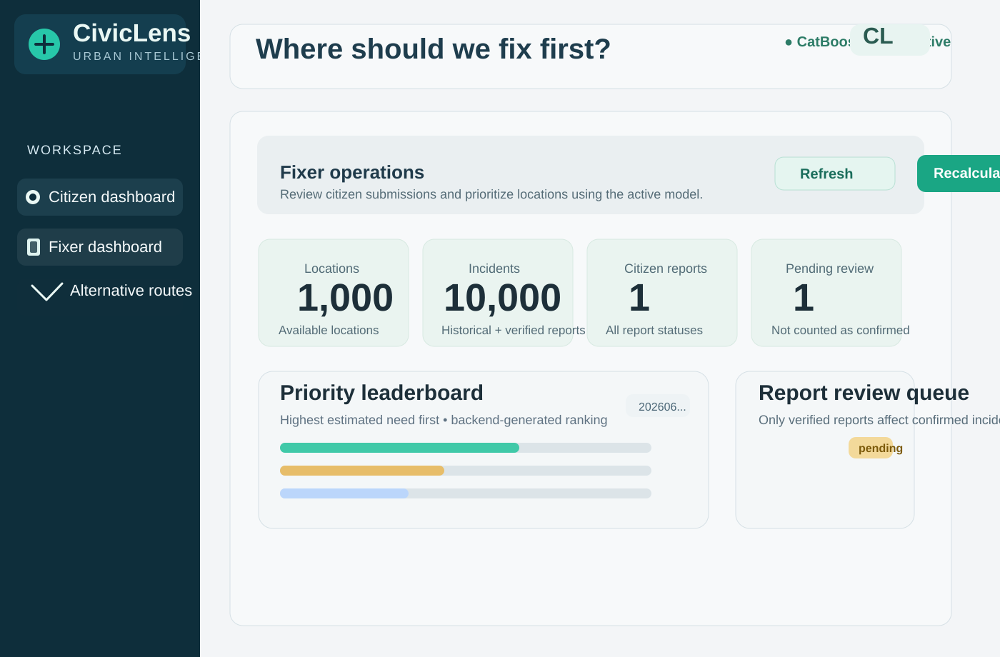
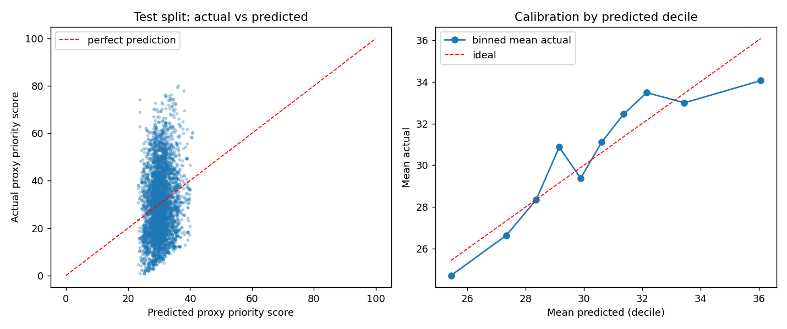
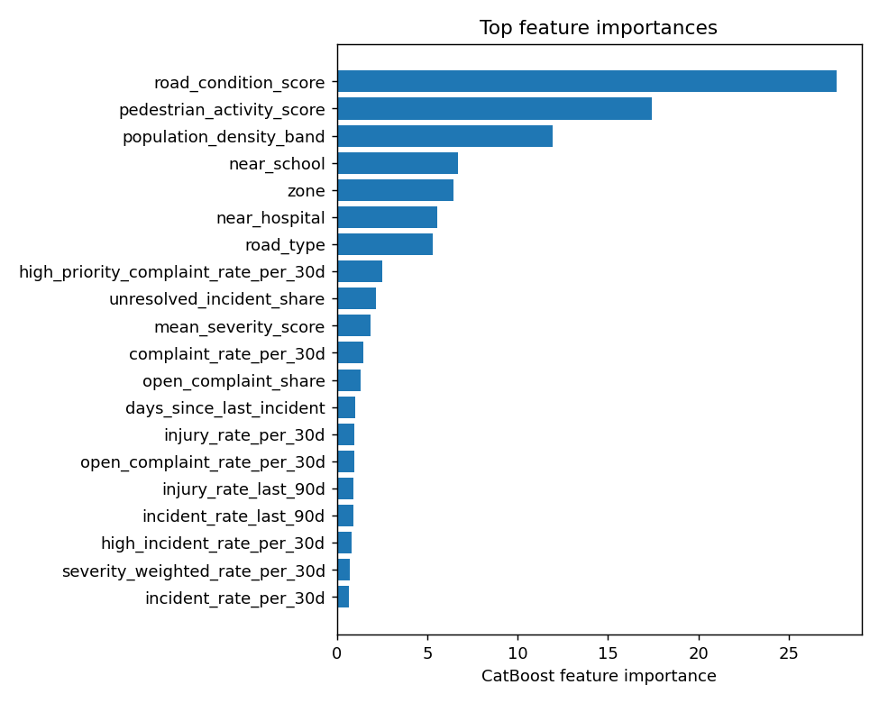

# CivicLens CatBoost priority model

CivicLens is a municipal operations dashboard that helps public works teams decide which
neighbourhoods and road segments need attention first. It combines historical incident data,
public complaints, and a CatBoost ranking model to surface the highest-need locations, then
re-scores them when a fixer verifies a new citizen report.

## Problem and target user

Cities often receive fragmented signals about infrastructure risk: road defects, injuries,
service complaints, and social media reports all arrive in separate streams. Without a shared
triage view, crews can spend time reacting to the loudest issue instead of the most urgent one.

CivicLens is built for:

- Municipal public works and street maintenance teams
- Fixer / operations reviewers who verify citizen submissions
- City analysts evaluating where to deploy scarce repair resources first
- Citizen service teams that need to turn local reports into actionable repair priorities

The product is designed to turn scattered, noisy evidence into a single, explainable priority
ranking that helps teams focus on the locations with the greatest estimated need.

## What the product looks like



## Sample model outputs

These assets show the model's output and explanatory diagnostics after training:





> **Read this first.** The data has **no genuine priority / repair-urgency / municipal-decision
> field** (`priority_reported` is a citizen-chosen flag, not an official decision). The model is
> therefore trained on a **documented proxy score**. It does **not** learn real municipal
> priorities, and the dataset is synthetic (see `data/DATASET_README.txt`).

## Quick start

```bash
pip install -r requirements.txt
python scripts/train.py            # trains CatBoost, writes artifacts/ and reports/
python -m unittest discover -s tests -t . -v      # or: pytest
python scripts/rank.py --top 20    # print the current ranking
uvicorn priority_model.api:create_app --factory --port 8000   # run the API
```

`train.py --quick` uses fewer iterations (smoke tests only). Training is **always an explicit
step**; reports arriving through the API never trigger retraining.

## Project layout

| Path | Purpose |
|---|---|
| `priority_model/config.py` | Vocabularies, proxy-score definition, split/snapshot settings, CatBoost params |
| `priority_model/validation.py` | Schema, missing values, duplicate IDs, timestamps, severity, unknown locations, coordinates |
| `priority_model/features.py` | Point-in-time features + proxy score |
| `priority_model/preprocessing.py` | Feature schema + safe record validation (shared by training and inference) |
| `priority_model/training.py` | Snapshots, time-aware split, CatBoost training, evaluation, artifacts |
| `priority_model/ranking.py` | Priority levels, supporting evidence, ranked table |
| `priority_model/service.py` | `PriorityService` - the only thing the website needs |
| `priority_model/store.py` | SQLite store for citizen reports (`runtime/reports.db`) |
| `priority_model/api.py` | FastAPI router |
| `data/` | Copy of the original CSVs (read-only; never overwritten) |
| `artifacts/` | `model.joblib`, `model.cbm`, `feature_schema.json`, `preprocessing_config.json`, `training_metrics.json`, `model_metadata.json` (created by training) |
| `reports/` | `evaluation_report.md`, `ranked_locations.csv`, plots, `feature_importance.csv`, `data_validation_report.json` (created by training) |

## Data preparation and validation

The loader checks required columns (hard error if missing), missing values, duplicate IDs,
unparseable timestamps, invalid severity, unknown `location_id`s and out-of-range coordinates.
Each action is counted in `reports/data_validation_report.json` (the supplied files are clean:
every count is 0). Policy: duplicates keep first; bad timestamp / severity / unknown location /
negative injuries rows are dropped; missing `resolved` is treated as unresolved; invalid
coordinates are blanked (coordinates are not model inputs).

## Training target (proxy)

For a location and a 60-day window, with `s(x,k) = 1 - exp(-x/k)`:

```
score = 100 * ( 0.25 * s(severity_burden, 6)      # sum of weights Low1/Medium2/High4/Critical8
              + 0.20 * s(injuries, 1.5)
              + 0.15 * s(unresolved_burden, 3)    # severity weights of incidents unresolved at window end
              + 0.10 * s(complaint_burden, 2.5)   # complaints weighted Low .5 / Normal 1 / High 2
              + 0.10 * s(open_complaints, 1.5)
              + 0.20 * location_condition )       # 0.40 road condition + 0.20 pedestrian activity
                                                  # + 0.15 near school + 0.10 near hospital + 0.15 density band
```

Limitations: weights and `k` constants are judgement calls (set from training-period magnitudes
only), not municipal policy; the score is not validated against real decisions.

## Leakage control and evaluation

* Features and label come from **different time windows**. For each cutoff date (every 15 days),
  features use only records with `timestamp <= cutoff`; the label is the proxy score of the
  **following 60 days**. Unresolved/open status is reconstructed *at the cutoff* from
  `timestamp + resolution_hours` / `created_at + days_to_resolution`, so later resolutions are not leaked.
* Train / validation / test are separated **by cutoff date** with a purge gap equal to the label
  window, so label windows never overlap across splits. The test split is used only for reporting.
* Excluded from features: `location_id`, latitude/longitude, exact population density (replaced by
  a 5-band value), so locations cannot be memorised. Totals are expressed as rates per 30 days of
  history so snapshots at different dates are comparable.
* Baselines: train-mean, and persistence (proxy score of the previous 60 days).
* Reported: MAE, RMSE, R², Spearman and top-5% overlap, actual-vs-predicted plots, feature
  importance - see `reports/evaluation_report.md` after training.

## Ranking output

`reports/ranked_locations.csv` (and `GET /api/priority-ranking`): `rank, location_id,
predicted_priority_score, priority_level, incident_count, complaint_count,
unresolved_incident_count, road_condition, supporting_evidence`, plus `recent_proxy_score_60d`
(the plain formula on the last 60 days), `injury_count`, `open_complaint_count`.

* Scores are clipped to 0-100.
* **Levels** are fixed at training time from quantiles of *predicted validation scores*:
  Medium >= P50, High >= P80, Critical >= P95, else Low (actual cut-offs in
  `preprocessing_config.json` and the report). They are relative triage bands, not absolute severity.
* `supporting_evidence` is generated from the raw records (counts, most frequent incident type,
  recency, road condition), never by the model.

## New citizen reports

1. `POST /api/reports` validates and stores the report as **pending** (ranking unchanged).
2. `POST /api/reports/{id}/verify` (fixer; may correct severity/injuries) turns it into a confirmed
   incident (`reported_by = Citizen`, unresolved), updates **that location's** aggregate features,
   re-scores it with the saved model, re-ranks, and returns before/after score, rank and level,
   changed features, how many locations shifted rank, and the top of the ranking.
   If the report is newer than all data, the service clock (`as_of`) advances and all locations are recomputed.
3. `POST /api/reports/{id}/reject` closes it without effect.
4. `POST /api/priority-ranking/recalculate` re-runs inference for all locations (no training).

Retrain explicitly (`scripts/train.py`) and then call `PriorityService.reload_model()` or restart.

## API

| Endpoint | Purpose |
|---|---|
| `GET /api/model/status` | version, metrics, thresholds, as-of date, report counts |
| `POST /api/model/predict` | `{"records":[{"location_id":"L0001"}, {<feature dict>}]}` - known locations or new aggregated/location records |
| `GET /api/priority-ranking?top=&level=&location_id=` | ranking |
| `POST /api/priority-ranking/recalculate` | refresh without retraining |
| `POST /api/reports`, `GET /api/reports/{id}`, `POST /api/reports/{id}/verify`, `/reject` | report workflow |

Mount in the existing backend: `app.include_router(create_router(PriorityService(artifacts, data, runtime)))`.
Invalid input returns HTTP 422 with `{"detail": {"errors": [...]}}`; unknown report 404; already
reviewed 409; model files missing 503 (standalone app).

Predict inputs: missing numeric values become NaN (CatBoost handles them) and missing/unseen
categories become `UNKNOWN`, each with a per-record warning. Errors are returned for non-numeric or
out-of-range values, unknown field names, empty input, or records with more than 50% features missing.
Raw `road_condition`, `pedestrian_activity`, `population_density_per_km2` strings/values are accepted
and converted to the model's features. Feature order is taken from `feature_schema.json`.

## Honest limitations

* Labels are a proxy; scores are *forecasts of the proxy*, not official priorities.
* In this synthetic data, per-location incident counts barely persist over time, so history carries
  little forecasting signal; expect weak skill and a ranking driven mostly by static location
  conditions. A single new verified report therefore moves the model score only slightly, while
  `recent_proxy_score_60d` and `supporting_evidence` react fully. Read the evaluation report before
  trusting the ranking, and consider showing both scores.
* About one year of data gives few time-ordered cutoffs and correlated windows.
* No spatial modelling (coordinates deliberately excluded).


## CivicLens web app (integrated demo)

A lightweight responsive frontend is included in `web/index.html`. It provides:
- Citizen dashboard with affected-area map, incident submission and report status.
- Fixer dashboard with CatBoost priority ranking, report verification/rejection and recalculation.
- Alternative route exploration using the public OSRM demo routing service (internet required).
- Persistent citizen reports in SQLite under `runtime/reports.db`.
- Backend endpoints for location map data, summary metrics and report listing.

### Run the integrated app

From this directory:

```bash
pip install -r requirements.txt
python scripts/train.py --quick   # only if artifacts/ is empty or model artifacts are missing
python run_civiclens.py
```

Open `http://127.0.0.1:8000`. The frontend and API are served from the same origin.
Swagger documentation is at `http://127.0.0.1:8000/docs`.

The model is trained once and loaded on backend startup; report verification triggers inference and ranking refresh, not retraining. The supplied datasets are synthetic and the target is a documented proxy, not an official municipal priority label. Do not present scores as calibrated safety probabilities.
